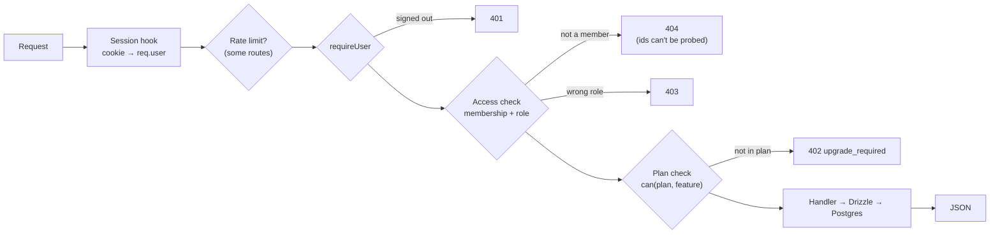
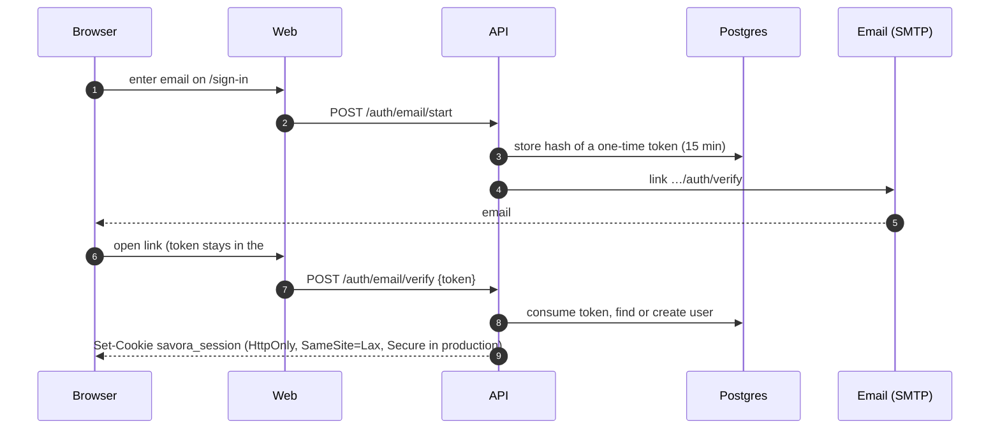
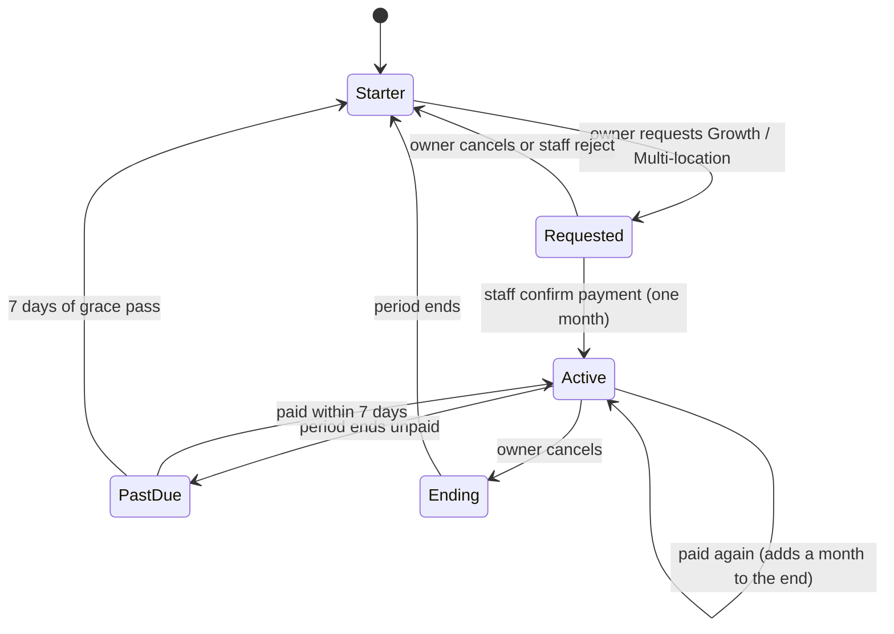

# @savora/api

The Savora API: a Fastify 5 server in TypeScript. It owns the database, sign-in, menus, billing,
photos, AI calls and the public guest endpoints. Browsers never call it directly: the web app
rewrites `/api/*` to it, and server-renders pages by calling it with the visitor's cookies.

```bash
npm run dev -w @savora/api        # http://localhost:4000 (from the repo root: npm run dev:api)
npm test -w @savora/api
```

Settings come from the root `.env` and are validated by [`src/env.ts`](src/env.ts) at start-up; in
production unsafe values stop the server (short session secret, `http://` origin, PGlite, demo seed,
no email service).

## How a request is handled



- **Access** ([`src/lib/access.ts`](src/lib/access.ts)): every organization, location, category and
  item is reached through the caller's membership. Roles: `owner`, `admin`, `editor`.
- **Plans** use `can()` from `@savora/shared`, the same rule the web app shows. With
  `NEXT_PUBLIC_PLANS_ENABLED=false` it allows everything (testing mode).
- **Errors** are logged with the request id; 5xx answers carry `{ error: 'internal', reqId }` and no
  internals.

## Endpoints

| Area | Endpoints |
|---|---|
| Health | `GET /health` (database check, version, uptime) |
| Sign-in | `POST /auth/email/start`, `POST /auth/email/verify`, `GET /auth/google/start`, `GET /auth/google/callback`, `GET /auth/providers`, `POST /auth/logout` |
| Workspace | `GET /me`, `POST /organizations`, `GET /organizations/:orgId/overview`, `POST /organizations/:orgId/locations` |
| Menu | `GET /locations/:id/menu`, categories and items (`POST`, `PATCH`, `DELETE`, `/move`), `POST /locations/:id/import` (paste), `POST /locations/:id/menu/read` (AI, photo/PDF), `POST /locations/:id/publish` |
| Photos | `POST /organizations/:orgId/media`, `GET /media/:id/:file` (public, cached a year) |
| Settings | `GET` / `PATCH /locations/:id/settings`, `GET /geocode` |
| Analytics | `POST /public/scan`, `GET /locations/:id/analytics` |
| Themes | `GET /locations/:id/themes`, `PUT /locations/:id/theme`, `POST` / `DELETE /organizations/:orgId/themes`, `POST /organizations/:orgId/themes/assistant` (AI) |
| Virtual trial | `GET /locations/:id/tour`, scenes (`POST`, `PATCH`, `DELETE`, `/move`, `PUT …/photo`), spots (`POST`, `PATCH`, `DELETE`), `POST` / `DELETE /locations/:id/tour/publish` |
| Billing | `GET /organizations/:orgId/billing`, `POST` / `DELETE …/billing/requests`, `POST …/billing/cancel` |
| Staff | `GET /staff/billing`, `POST /staff/billing/requests/:id/approve` / `reject` |
| Guests | `GET /public/menu/:slug`, `GET /public/tour/:slug`, `GET /public/sitemap` |

Rate limits: sign-in links 5 per email and network per 10 minutes; scans 30 per minute; address
search 20 per minute; AI 30 per person per hour.

## Signing in

Passwordless email links, plus Google when configured. Sessions are random tokens in an HTTP-only
cookie; only their SHA-256 hash is stored, and they last 30 days.



Google sign-in uses the standard OAuth code flow with a signed `state` cookie; the redirect URI is
`<WEB_ORIGIN>/api/auth/google/callback`.

## Plans and billing

Billing is manual (bank transfer or cash), behind a `BillingProvider` interface
([`src/lib/billing.ts`](src/lib/billing.ts)) so a card provider can replace it. An owner requests a
plan and gets a payment reference; Savora staff confirm the payment, which activates a month.
Subscriptions settle themselves hourly, on `/me` and on the billing screen:



Nothing is deleted by a smaller plan: extra branches pause (guests see "taking a short break"),
analytics shows a locked screen, and saved order and booking links are kept but hidden.

## AI

Reading a menu from photos or a PDF, and the Theme assistant, go through an `AiProvider` interface
([`src/lib/ai.ts`](src/lib/ai.ts)) implemented with **OpenRouter**:

- Strict structured outputs built from zod schemas; only endpoints that honour them are used
  (`provider.require_parameters`), and every answer is validated again.
- Photos are shrunk to 2,000 px JPEG and sent as data URLs; PDFs as `file` parts.
- The Theme assistant designs the whole look, not only colours: heading typeface, header, corners
  and dish layout. When the owner asks, it uses their photos (numbered "Photo 1", "Photo 2" in the
  conversation) as the logo or header photo; those apply together with the theme
  (`PUT /locations/:id/theme` with `logoPhotoId` / `coverPhotoId`).
- Every theme palette is checked and nudged to WCAG AA before an owner sees it.
- Failures map to "declined", "too long" and "busy" (rate limits, 5xx, out of credit).

Set `OPENROUTER_API_KEY` (and optionally `OPENROUTER_MODEL`); without a key the endpoints answer
503 `ai_unavailable` and the screens say the feature is not switched on yet.

## Photos and media

Uploads are re-encoded with sharp: rotation applied, metadata (including GPS) removed, a WebP for
display (1,600 px; 2,400 px for tour scenes) and a 480 px thumbnail. Files live in `MEDIA_DIR`
(default `~/.savora/media`; `/data/media` in Docker) behind a two-method `MediaStore` interface, so
object storage can replace the disk later. Tour photos are also measured for sharpness, brightness
and size to suggest retakes.

## Source map

```
src/
├─ server.ts        Start-up: migrations, demo seed, hourly jobs, graceful shutdown
├─ app.ts           buildApp(): plugins, hooks, error handler, routes (also used by tests)
├─ env.ts           Settings schema and production checks
├─ auth/            Sessions and the requireUser guard
├─ routes/          One file per area (auth, workspace, menu, public, scans, settings,
│                   billing, themes, tour)
├─ lib/             access, billing, ai, media, geocode, tour-quality, tokens, slug
├─ mailer.ts        Console mailer (development) and SMTP mailer
└─ seed.ts          The demo workspace
```

## Tests

`src/app.test.ts` builds the real app against PGlite in memory with the real migrations and drives it
with `app.inject()`: no mocks between the API and SQL. Email, AI and geocoding are in-memory
stand-ins. `src/lib/ai.test.ts` checks the exact OpenRouter requests and error handling with a fake
network.
