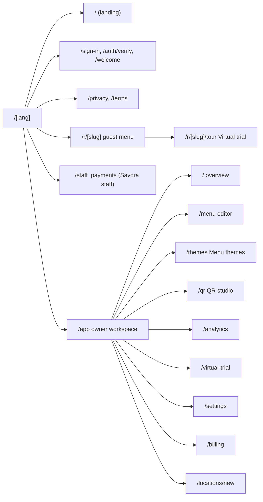
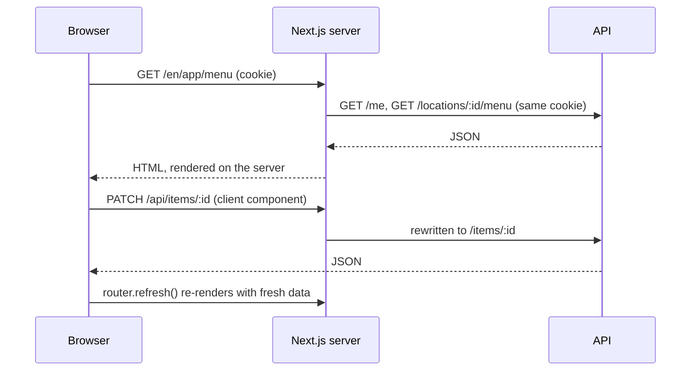

# @savora/web

The Savora website: the public landing page, the owner workspace and the guest menus. Next.js 16
(App Router, React 19, server components) with Tailwind CSS 4, in English and Arabic.

```bash
npm run dev -w @savora/web      # http://localhost:3000 (from the repo root: npm run dev:web)
npm run build -w @savora/web    # production build (standalone server)
npm run lint -w @savora/web
```

The API must be running too (see the root README). This app reads the root `.env`.

> **Next.js 16** has breaking changes from earlier versions (for example `proxy.ts` instead of
> middleware, async `params`, typed `PageProps`). Read `node_modules/next/dist/docs/` before using an
> API you haven't used here; run `npx next typegen` after adding a route.

## Pages

Every page lives under a language segment, `/en` or `/ar`. [`src/proxy.ts`](src/proxy.ts) sends bare
paths (including printed QR links like `/r/saltandstem`) to the visitor's language.



Search engines see the landing page, legal pages and published guest menus (`robots.txt`,
`sitemap.xml`, structured data). The workspace, staff and auth pages send `noindex`.

## How data flows

Pages are server components that call the API with the visitor's cookies
([`src/lib/api.ts`](src/lib/api.ts)). Client components change data through `/api/*`, which
[`next.config.ts`](next.config.ts) rewrites to the API on the same origin, so the session cookie is
first-party and no CORS is involved.



Two route handlers live here instead of the API: `/api/health` (checks the web app, the API and the
database for uptime monitors) and `/api/public/scan` (passes the guest's address on for counting).

## Languages and right-to-left

- **Text:** [`src/app/[lang]/dictionaries/en.json` and `ar.json`](src/app/%5Blang%5D/dictionaries)
  hold every string. Keep their keys identical; Arabic adds plural forms (`zero`, `two`, `few`,
  `many`), used through `plural()` in [`src/lib/plural.ts`](src/lib/plural.ts).
- **Direction:** the layout sets `dir="rtl"` for Arabic. Use logical utilities (`ms-`, `pe-`,
  `start-`, `end-`) so everything mirrors; add `rtl:` variants only for icons that point somewhere.
- **Numbers:** Latin digits in both languages (`ar-u-nu-latn`); prices go through `formatPrice()`.
- **Fonts:** Poppins for Latin, Tajawal for Arabic, loaded with `next/font`.
- **Mixed content:** text in the other language gets `lang` (and `dir` when needed), so screen
  readers and fonts handle it correctly.

## Design system

- **Tokens** in [`src/app/globals.css`](src/app/globals.css) mirror the Figma variables, in light and
  dark. Use `bg-surface`, `text-ink`, `text-muted`, `border-line`, `bg-brand-fill` (red behind white
  text), `text-brand` (red text), `text-gold-ink` (gold text on light surfaces). They meet WCAG AA in
  both themes; check new colour pairs before adding them.
- **Components:** small primitives in [`src/components/ui`](src/components/ui) (Button, Card, Dialog,
  Field, Segmented, Switch, Badge, Logo); screens in folders by area.
- **Guest menu themes** replace the colour tokens on the guest page only, through `themeVars()` from
  `@savora/shared`; Auto-match keeps the default tokens and dark mode. The rest of a theme's look is
  set with data attributes on the menu frame (`data-menu-font`, `data-corners`) and the
  `--r-*` radius variables in `globals.css`; header and dish layout are chosen in the page. Heading
  fonts live in [`src/lib/menu-fonts.ts`](src/lib/menu-fonts.ts) and are never preloaded, so a menu
  downloads only the one it uses.
- **Landing page** is built from the Figma frame "Savora / Landing" in
  [`src/components/landing`](src/components/landing); its photos and icons are in
  `public/images/landing`.

## Folder structure

```
src/
├─ proxy.ts              Redirects bare paths to /en or /ar
├─ instrumentation.ts    Logs server errors as JSON lines
├─ app/
│  ├─ [lang]/            Pages, layouts, dictionaries, social preview image
│  ├─ api/               health and public/scan route handlers
│  ├─ robots.ts, sitemap.ts
│  └─ globals.css        Tokens, type scale, animations
├─ components/           By area: landing, menu, guest, tour, themes, billing, settings, qr, …
├─ content/legal.ts      Privacy and Terms text (EN/AR)
└─ lib/                  API client, workspace context, plural, site origin, JSON-LD
```

## Settings

| Setting | Purpose |
|---|---|
| `API_ORIGIN` | Where the API runs (default `http://localhost:4000`) |
| `PUBLIC_MENU_ORIGIN`, `SITE_ORIGIN` | Public address for QR codes, canonical links and the sitemap |
| `NEXT_PUBLIC_PLANS_ENABLED` | `false` unlocks everything for testing; baked in at build time |
| `NEXT_PUBLIC_MAP_TILES` | Map tile URL template for production; baked in at build time |
| `EXAMPLE_MENU_SLUG` | The published menu the landing page links to |
| `SUPPORT_EMAIL` | Contact shown on Privacy and Terms |

## Performance and accessibility

Public pages keep their browser JavaScript small: client components import only zod-free helpers
(`@savora/shared/locale`, `@savora/shared/format`). Guest menus are server-rendered with no layout
shift. Every page passes an axe-core WCAG 2.1 AA audit in light and dark; keep it that way when adding
colours (no opacity-faded text) and controls (visible text inside accessible names).
