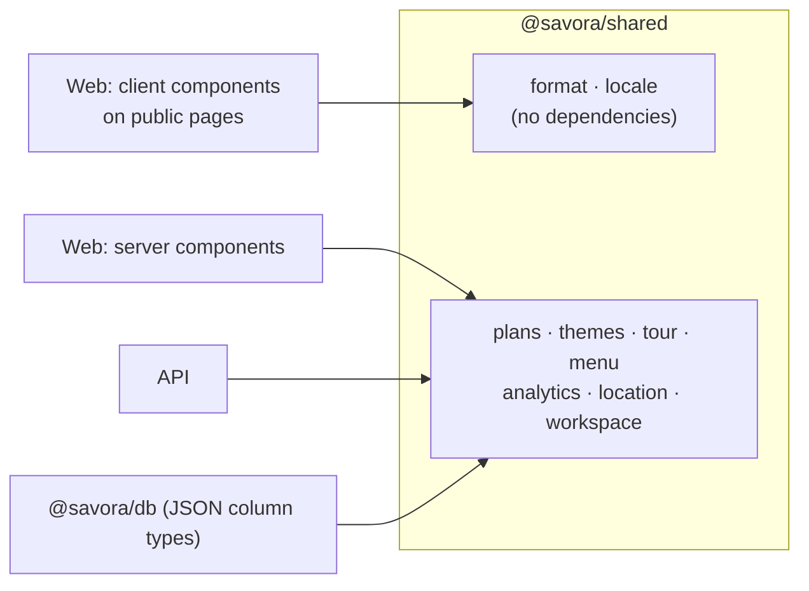

# @savora/shared

Types, validation and business rules used by both the web app and the API, so the screens and the
server can never disagree: a price is parsed the same way, a theme passes the same contrast check, a
plan unlocks the same features. Plain TypeScript with no framework code; the only dependency is zod.



## Modules

| Module | Holds |
|---|---|
| `menu.ts` | Menu types and validation (zod), the paste parser, price parsing (Arabic digits too), snapshots for publishing, the guest menu shape |
| `plans.ts` | Plans and prices, `can(plan, feature)`, location limits, billing periods and grace (`settle`), the testing switch |
| `themes.ts` | The nine theme presets, WCAG contrast (`checkTheme`, `fixContrast`), guest-page CSS variables (`themeVars`) |
| `tour.ts` | Virtual trial types, photo quality scoring, publish checks, spot validation |
| `analytics.ts` | Scan charts and the written insights |
| `location.ts` | Opening hours, closures, open/closed status, time zones |
| `workspace.ts` | `/me`, organizations, locations |
| `locale.ts` | `en` / `ar`, text direction |
| `format.ts` | `formatPrice`, `fill` (dictionary placeholders) |

## Importing

```ts
import { can, checkTheme, type PublicMenu } from '@savora/shared'; // API and server components
import { formatPrice, fill } from '@savora/shared/format';          // browser code on public pages
import { LOCALES } from '@savora/shared/locale';
```

The package root pulls in zod (about 90 KB in the browser). Client components on public pages
(landing, guest menu, sign-in) import from the `format` and `locale` sub-paths instead; keep new
helpers they need free of dependencies and export them there.

## Plans switch

`plansEnabled()` reads `NEXT_PUBLIC_PLANS_ENABLED`: set to `false`, `can()` allows every feature,
`locationLimit()` is unlimited and `pausedLocations()` pauses nothing. It is read at call time on the
server and inlined at build time in the browser; both apps read the same root `.env`.

## Tests

```bash
npm test -w @savora/shared
```

Every rule here is unit-tested: plan periods and grace, the paste parser, contrast and its fixes,
photo quality thresholds, analytics insights and opening hours across time zones.
